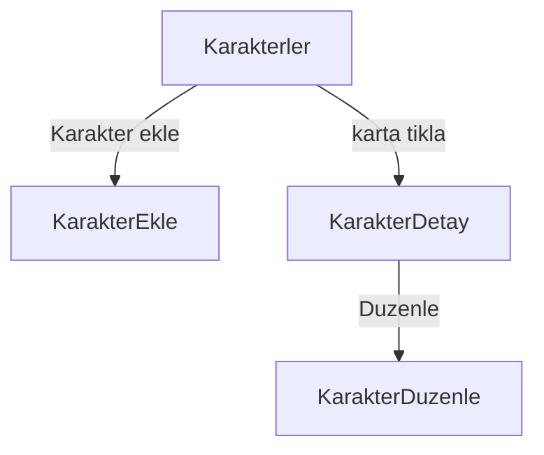
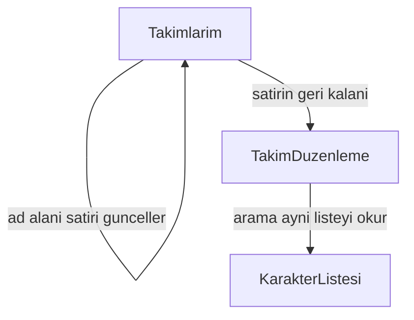
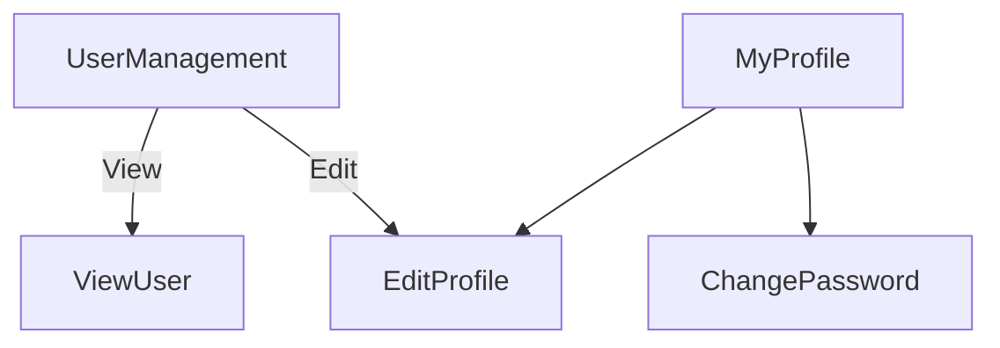
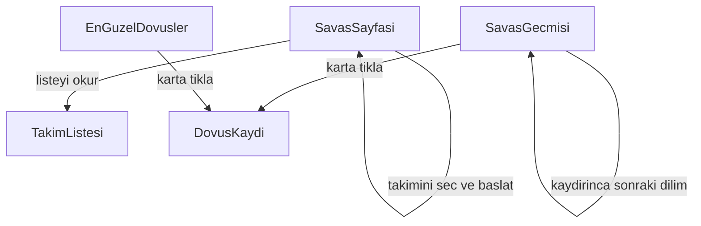
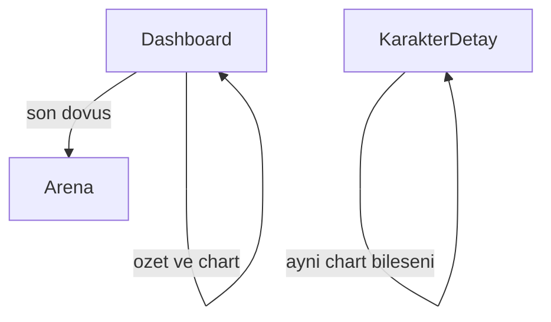
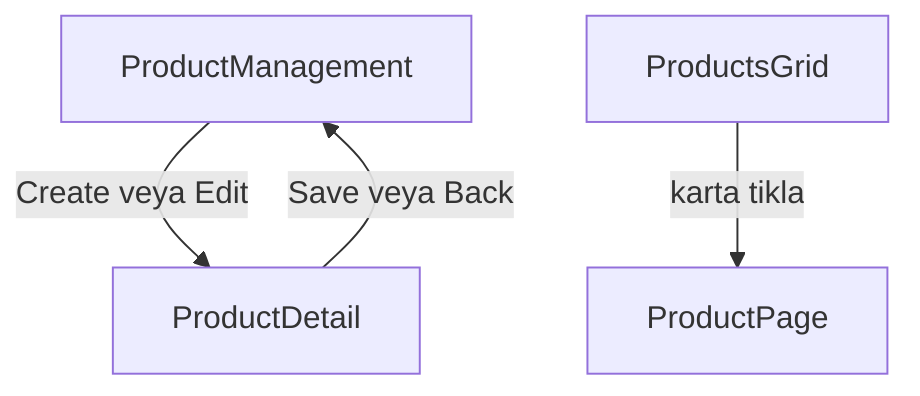

# Geliştirme Checkpoint

Son güncelleme: 19 Ekim 2026 — Dövüş formülü ve dashboard sayfa modeline kilitlendi (bölüm 2). Kod henüz yok. Yer sayısı 5. WebSocket / SignalR sonra. E-ticaret dashboard’dan sonra. Cookie kararı danışmanda. Permission hâlâ DB. Sil’in soluk kırmızısı dosyada yok.

## Yeni chat’e geçerken oku

1. Bu dosya (`CHECKPOINT.md`)
2. `PROJE_MANTIGI.md` — ürün / mimari özet
3. `PROJE_EKLEMELERI.md` — adım checklist
4. İsteğe bağlı: `.cursor/rules/react-ogrenme.mdc`
5. **Çarşamba görüşme:** `AUTH-REACT-CALISMA.md` (Auth + React dersi)

---

## 1. Sayfa modeli — 14 Ekim 2026 (19 Ekim güncellendi)

Giriş yapılmış sayfalar Light Blue kabuktadır. Kabuk `AppLayout` içindedir. Sol menü ve üst çubuk `web/src/shell` altındadır. Giriş ve kayıt kabuğun dışında, mor palette kalır. Menü altı modülü taşır: dashboard, karakter, takım, kullanıcı, arena, e-ticaret. Girişten sonra varsayılan adres Dashboard’dur. E-ticaret dashboard ve savaş tablosundan sonra yapılır. Aynı metin: `CursorMarkdowns/Sayfa-Modeli.md`.

### Karakterler

Katalog paylaşılan listedir. Giriş yapmış herkes aynı karakterleri görür. `Universe` eserin dünyasıdır. `Karakter ekle` katalog kartını doğurur. Takıma üye yazmak bu modülün işi değildir.

Liste `GET /api/characters` ile dolar. İlk dilim `page` ve `pageSize` ile gelir. Arama aynı çağrıya metin ekler. ASP.NET liste action’ı query’yi okur. `HttpClient` yine `GET` atar.

- `/characters` liste ve arama
- `/characters/new` kataloga kart yazma
- `/characters/:id` detay
- `/characters/:id/edit` düzenleme



### Takımlar

Bir kullanıcının birden fazla takımı olur. Takımlarım yalnız onun satırlarını alta doğru dizer. Her takım yatay bir satırdır. Satırda sabit 5 yer vardır. Bütün takımlar aynı sayıya uyar. Dövüşe girmek için 5 yer de dolu olmalıdır.

Yeni takım boş satır olarak doğar ve aynı sayfada silinir. Her satırın adı ayrı bir alandan yazılır. O alana basmak düzenlemeye götürmez. Satırın geri kalanına basmak düzenlemeyi açar. Satır boş da olsa dolu da olsa aynı kapı çalışır. Ad alanı takım satırını günceller. Satıra tıklamak adres değiştirir. Düzenleme sayfası kendi `GET` isteğini atar.

Düzenlemede üstte takımın yerleri durur. Altta karakter aranır. Arama katalog listesiyle aynı `GET` çağrısıdır. Bu sayfada katalog oluşturma yoktur. Karakter sürüklenince bir yere girer veya takımdan çıkar. Ekle butonu da aynı üyeliği yazar. Üyelik, takım kimliği ile karakter kimliğini bir satıra kaydeder. Çıkarma o satırı siler. Sınır dolunca yeni karakter girmez.



### Kullanıcı

User modülü Light Blue şablonundaki ekranlardır. Giriş ve kayıt bu modüle girmez. Menüde Users tabloyu açar. User Management altında My Profile, Edit Profile ve Change Password durur.

User Management bir tablodur. Kolonlar avatar, ad, soyad, telefon, e-posta, rol, disabled ve aksiyonlardır. Aksiyonlar View, Edit ve Delete’tir. Tabloda arama ve sayfa boyutu vardır. Liste `GET /api/users` ile dolar. View tek kaydı `GET /api/users/{id}` ile salt okunur açar. Delete `DELETE /api/users/{id}` olur ve `users.delete` iznine bakar.

Edit Profile ad, soyad, telefon, e-posta ve avatar yazar. Save, Reset ve Cancel durur. Aynı form hem tablodan açılan düzenlemede hem kişinin kendi profilinde kullanılır. Change Password mevcut parolayı, yeni parolayı ve tekrarını alır.

My Profile iki parçadır. Solda kapak, avatar, ad ve iletişim durur. Sağda Activities kolonu durur. Yazı, yorum ve Post kutusu o kolondadır.



### Arena

Savaş sayfası kullanıcının takımını seçtirir ve dövüşü başlatır. Kapı sade kalır. Sayfa açılınca takım listesi okunur. Bu okuma Takımlarım’ın listesiyle aynıdır. Başlatma `POST /api/battles` ile `{ teamId }` gider. Rakip, hesap ve sonuç aynı cevapta döner. Sayfa cevabı kendi içinde aralıklı oynatır. Ayrı oyun sayfası açılmaz. Formül ve puan bölüm 2’dedir.

Savaş geçmişi, kullanıcının başlattığı veya rakip olduğu bitmiş dövüşleri grid’de gösterir. İlk dilim çizilir. Listenin sonu görünürse sonraki dilim gelir. Her dilim `page` ve `pageSize` ile bir `GET` olur. ASP.NET bunu `Skip` ve `Take` ile okur. Karta basınca `GET /api/battles/{id}` olay listesini getirir.

En güzel dövüşler `/arena/highlights` rotasındadır. Liste `IsHighlighted` işaretli dövüşleri okur. İşareti kim koyacağı sonraki iştir.

- `/arena` — takım seç, başlat, oynat
- `/arena/history` — kişisel geçmiş
- `/arena/highlights` — seçilmiş dövüşler
- `/arena/battles/:id` — kayıtlı olay listesi



### Dashboard

Dashboard Light Blue yerleşimindedir. Üstte özet şeritler, ortada büyük panel, yanında istatistik, altta chart kutuları ve listeler durur. Chart bileşeni bir kez yazılır. Dashboard ve karakter detayı onu kendi sayılarıyla çağırır. SPA’da bileşen import edilir. ASP.NET’te her sayfa kendi `GET` query’sine gider.

Sayılar şablondan kopya yazı olmaz. İki kaynaktan gelir. Birinci kaynak dövüş ve katalog satırlarıdır: kazanma, puan, nadirlik, son dövüşler `GroupBy`, `Count` ve `Sum` ile okunur. İkinci kaynak dashboard seed verisidir: dünya haritası ve karakterin bölge bilgisi gibi paneller tabloya yazılır. Borsa, e-posta ve takvim kopyalanmaz. Yerlerine arena özeti, karakter dağılımı, puan şeridi ve son dövüş listesi konur.

Dashboard ekranı dövüş tablosundan sonra yapılır. Metne 19 Ekim’de girdi. Rota `/` (giriş sonrası varsayılan).



### E-ticaret

E-ticaret dashboard ve savaş tablosundan sonra yapılır. Dört ekran şablondaki yerleşimle durur. Vitrin ürünleri listeler. Puanla veya parayla satın alma bu sıranın ardından gelir. Add to Bag şablonda durur ve bu sırada sepete satır yazmaz.

Product Management yöneticinin tablosudur. Kolonlar kimlik, resim, başlık, alt başlık, fiyat ve yıldızdır. Create Product forma gider. Edit aynı formu doldurur. Delete satırı siler. Arama ve sayfa boyutu vardır. Liste `GET /api/products` ile dolar.

Product Detail, Edit product formudur. Resim, başlık, alt başlık, fiyat, indirim, iki açıklama, kod, hashtag, teknoloji ve yıldız buraya yazılır. Save `PUT /api/products/{id}` atar. Delete `DELETE` atar. Back tabloya döner. Resim, karakterdeki `ImageUrl` gibi bir adrestir.

Products Grid herkesin gezdiği vitrindir. Kartta resim, başlık, alt başlık, fiyat ve yıldız durur. Tip, marka, beden, renk, aralık ve sıralama aynı `GET` çağrısına query olarak gider. Karta basınca Product Page açılır. Grid satır yazmaz.

Product Page tek ürünü büyük resim, fiyat, açıklama, kod ve teknoloji ile gösterir. Altta benzer ürünler listeden gelir. Sayfa `GET /api/products/{id}` ile okunur. Beden, adet ve Add to Bag şablondaki yerindedir.



---

## 2. Arena ve savaş — kilit (19 Ekim 2026)

Kod bu turda yazılmaz. Entity, migration, handler ve React sayfası “yaz” denince açılır.

### Takım ve rakip

İki taraf da savaşa 5 karakter gönderir. Takımda boş yer varsa `POST` 400 döner. Rakip, dövüşü başlatan handler’ın içindedir; kapıda kurulmaz. Önce başka kullanıcının 5’i dolu takımı seçilir. İki takımın `BaseHealth + BaseAttack + BaseTechnique` toplamı birbirine en yakın olan alınır. Kendi takımlar elenir. Böyle takım yoksa katalogdan 5 karakterlik sistem dizilimi kurulur. Sistem diziliminin takım satırı yoktur. Geçmişe düşer, puan yazmaz.

Eğlenceli olan tüm dövüş sistemidir. Farklı evrenlerden karakterler aynı arenada kapışır. `Universe` yalnız eserin adıdır. Evren katsayısı yoktur. Güç karakter satırındaki sayılardadır.

### Güç sayıları

Kodda duranlar: `BaseAttack`, `BaseDefense`, `BaseSpeed`, `Rarity` (1–5). Henüz kolonu yazılmayanlar: `BaseHealth`, `BaseTechnique`, `BaseAccuracy`, `BaseForesight`. Aralık 0–9999. Entity, validator, migration, create/update ve form aynı dilimde gider. `Universe` ve `Rarity` hasara girmez. `Rarity` dövüş kopyasında yıldız olarak durur.

### Tur ve vuruş

Sıra `BaseSpeed` ile kurulur. Yüksek olan önce hareket eder. Hızlar eşitse küçük yer numarası (soldan sağa 1–5) önce gelir. İki tarafta aynı yer varsa dövüşü başlatan taraf önce hareket eder. `BaseAccuracy` sırayı kurmaz.

Hedef önce aynı yer numarasındaki rakiptir. O yer boşaldıysa yaşayan en yakın yer seçilir.

Bir hareket iki vuruştur. Önce normal (`BaseAttack`), sonra teknik (`BaseTechnique`). İkisi aynı hedefe gider. Normal vuruş hedefi düşürürse teknik vuruş yaşayan sonraki rakibe döner. Hedef kalmadıysa teknik yazılmaz.

Isabet kura değildir. Saldıranın `BaseAccuracy` değeri savunanın `BaseForesight` değeriyle karşılaştırılır. Accuracy büyük veya eşitse vuruş varır. Foresight daha büyükse vuruş görülür. Görülen vuruşta Foresight, Accuracy’nin iki katından büyük veya eşitse hasar 0’dır. Değilse darbe yarıya iner. Sonra `BaseDefense` uygulanır. Aynı iki takım her seferinde aynı dövüşü üretir. `Battle` satırında Random başlangıç sayısı yoktur.

```csharp
var strike = partial ? attack / 2 : attack;
var damage = strike == 0 ? 0 : strike * strike / (strike + defense);
```

Savunma 0 ise hasar kalan saldırı değeridir. Değmiş vuruşta sonuç 0’a yuvarlanırsa hasar 1 olur. Can `BaseHealth` ile başlar. 0’a inen karakter hareket etmez ve hedef olmaz. Bir taraf düşünce dövüş biter. 30 tur süre değildir; kimse düşmezse hesap kesilir. Kalan can toplamı büyük olan kazanır. Eşitse berabere. Handler bunu tek istekte yazar.

### Hesap ve oynatma

Hesap sunucudadır: `POST /api/battles` → handler döngüsü → `Battle` + olay satırları → tek `SaveChanges` → özet ve olay listesi. Oynatma tarayıcıdadır: React listeyi tutar, satırlar kısa aralıkla belirir, can çubuğu güncellenir, “hepsini göster” aralığı atlar. Geçmişten `GET /api/battles/{id}` aynı listeyi getirir.

WebSocket / SignalR bu dilimde yok. Sonra, olay modeli durduğu sürece aynı satırları akış olarak yollayan ikinci yol olur. Formül yeniden yazılmaz. Redis ve kuyruk bu savaş tasarımına bağlı değildir.

### Sonuç ve puan

`Battle` satırında başlatan kullanıcı, takımı, rakip kullanıcı (sistemde boş), tur sayısı, bitiş zamanı ve sonuç durur. Olay satırında tur, vuran yer, normal/teknik, hedef yer, sonuç (ıska, tam kaçınma, yarım darbe, tam darbe), hasar ve kalan can yazılır. Katalog değişince geçmiş bozulmasın diye ad, evren, yer, taraf ve yedi sayı o anda kopyalanır.

Kazanan 100 puan alır. Kaybeden 0 alır. Beraberlikte iki taraf 25 alır. Sistem dizilimine karşı puan yoktur.

### Yol haritası konumu (19 Ekim)

1. Görsel template — yarım (kabuk var, modül sayfaları yok).
2. Sayfa kararı — büyük kısmı kilitli; ekran ve tablolar yazılmadı.
3. Microservices + Docker — sonra.
4. K8s (HPA) — Docker’dan sonra.
5. SignalR / Redis / Queue — dövüş ve dashboard oturunca SignalR ayrı adım; Redis/Queue ihtiyaçta.

---

## Proje mantığı (özet)

- Anime/film/comics karakter koleksiyonu + battle arena + puan → ödül
- Backend: .NET 10, DDD, CQRS (MediatR), FluentValidation, EF Core, SQL Server, JWT (Admin/Player)
- Katmanlar: Domain → Application → Infrastructure → Api
- Frontend: React + TypeScript (Vite) — `web/`
- Klasör: `D:\ReactBattleArena`
- Referans: `D:\BattleArenaAndFigures\BattleArena`
- Api: `https://localhost:7275` · Vite: `http://localhost:5173` (CORS hazır)

Detay: `PROJE_MANTIGI.md`

---

## Öğrenci profili

- Web developer (.NET API). WinForms yok — Razor/HTML/`fetch`.
- React sıfırdan; takılan JSX/syntax oturumda açıklanır (`REACT-OGRENIM.md`).

## Öğrenme kuralları (HER OTURUM)

- Cursor: yönlendirme; kod VS Code’da.
- 1–2 kavram / oturum; adım adım; WinForms örneği yok.
- **Açıklamalar:** biraz **daha uzun** (kavram + neden + C#/web eşlemesi). Not: `REACT-OGRENIM.md`.

---

## Şu an neredeyiz?

- [x] Backend Adım 1–15
- [x] React faz 0–5
- [x] Faz 6 kart grid + Create ayrı sayfa
- [x] Characters frontend CRUD
- [x] AppLayout + Outlet
- [x] UI renk: giriş/kayıt koyu mor 60-30-10 (`index.css`). Giriş yapılmış sayfalar Light Blue kabuk (13 Eki, Adım 32)
- [x] **API/auth helper** — `web/src/api.ts`
  - `apiFetch` + `getToken` / `setToken` / `clearToken`
  - Login/Register `auth: false`; diğerleri Bearer varsayılan
  - Taşınan: Login, Register, Characters, Create, Detail, Edit, AppLayout
  - Notlar: `REACT-OGRENIM.md` (`apiFetch` öğretimi + helper tamamlandı)
- [ ] Liste yükleme 3–4 sn gecikmesi
- [ ] UI ince ayar (login/register boyama)
- [x] **`PROJE_EKLEMELERI.md` ← React Adım 16–28** (14 Ağu; gerçek sırayla)
- [ ] **Adım 29 RBAC** — Role + Permission (refresh token yok)
  - [x] Domain entity’ler + EF configuration + DbSet (`dotnet build` OK)
  - [x] Migration `AddRbacTables` + `AuthSeeder` (Users.Role → UserRoles)
  - [x] `IUserPermissionService` (join; UserPermission tablosu yok)
  - [x] `HasPermission` Characters CUD; Player’a RolePermission + UserRoles ile 201
  - [x] Register `UserRoles` + `GET /api/auth/me` permissions
  - [x] React `hasPermission` — liste Ekle, detay Düzenle/Sil (`/me` şart)
  - [x] Create URL kapısı — `meLoaded` + `/me` + `Navigate` (`CharacterCreatePage`)
  - [x] Edit URL kapısı — `characters.update` (`CharacterEditPage`); Sanji listeye düşer
  - [x] `PermissionContext` + AppLayout `/me`; liste + Create/Edit/Detail `usePermissions`
  - [x] RefreshToken Domain + EF + migration `AddRefreshTokens`
  - [x] Login cevabına refresh (hash DB, ham JSON)
  - [x] `POST /api/auth/refresh` + rotation (14–15 Eyl) — `Hash` ortak SHA256, `RefreshCommand` + validator + handler, `RefreshRequest`, `[AllowAnonymous]` action
  - [x] React: 401’de sessiz yenileme (`api.ts`) — `refreshSession` + `refreshInFlight`, yeni Bearer ile tek tekrar, 403 dokunulmaz
  - [x] `POST /api/auth/logout` (16 Eyl) — `LogoutCommand` + validator + handler, `LogoutRequest`, 204; `Revoke`’un ikinci kullanımı, süre kontrolü yok (çıkışta gereksiz)
  - [x] React Çıkış (16 Eyl) — `api.ts` `logout()` düz `fetch` + `clearToken`; `AppLayout` `handleLogout` `async`
  - [x] `/me` 401 kapısı (16 Eyl) — `loadMe` 401’de `clearToken` + `navigate('/login')`; önce yetkisiz sayfada kalıyordu
  - [x] `ExpireMinutes` 60’a geri alındı
  - [x] Temizlik: `RefreshCommand` namespace’i `Authentication.Commands`, 4 gereksiz `using` silindi
  - [x] Reuse detection (17 Eyl) — `RefreshCommandHandler`: iptal edilmiş token gelirse o kullanıcının `RevokedAtUtc == null` satırlarının hepsi iptal, dönüş yine 401. Test A/B ile doğrulandı
  - [ ] `LogoutCommandHandler`’daki kullanılmayan `Domain.Authentication` using’i (küçük)
- [x] **Light Blue kabuk (13 Eki, Adım 32)** — şablon npm paketi değil, `light-blue-react` referans. Menü ve üst çubuk `web/src/shell`. Hamburger sayfa sayfa değil: `AppLayout` `Outlet` çevresine takıldı, karakter rotaları oradan çiziliyor. Login/register kabuğun dışında
- [x] Kart: kolon sabit, yükseklik resmin en-boy oranı. İş butonu info, geri linki default (`characters-page__back`), Sil danger. Bootstrap `btn` / `form-control` yok
- [ ] Sil soluk kırmızı (`$red-dark`) — istenmişti, `CharactersPage.css` hâlâ canlı danger
- [ ] Battle Arena backend — formül 19 Eki kilitli (bölüm 2); entity/handler yok
- [ ] Dashboard ekranı — sayfa modelinde; dövüş tablosundan sonra

## Karar notları

- **Dövüş kilidi (19 Eki):** 5 yer, rakip `POST` içinde, iki vuruş, isabet karşılaştırma (kura yok), beraberlik 25 puan, WebSocket sonra. Detay bölüm 2.
- **Dashboard (19 Eki):** Light Blue yerleşim, gerçek SQL + seed harita verisi; e-ticaretten önce ekran, dövüş tablosundan sonra implement.

- Mega Grid yok; `CharacterCard` + sayfa CSS grid.
- **Renk:** Giriş ve kayıt hâlâ `#1e1a24` / `#2e2838` / `#b39bc9`. Giriş yapılmış karakter sayfaları Light Blue kabukta. Mor token’lar `index.css` `:root` içinde duruyor; kabuk onları ezmiyor çünkü login `AppLayout` dışında.
- **HTTP:** sayfalarda doğrudan `localhost` + `fetch` yok; sadece `api.ts`.
- Player CUD: permission yoksa 403; `RolePermissions` + `UserRoles` varsa 201 (yeniden login gerekmez).
- Scalar’da karakter JSON’u Register’a gitmesin — UserName/Email/Password 400’ü odur.
- Firefox CORS + status null → çoğu zaman Api kapalı / sertifika.
- Pedagoji: açıklamalar daha uzun (11 Ağustos+).
- UI gizleme ≠ yetki: link yok olsa da `/characters/new` API’de 403.
- Detayda `/me` yoksa `permissions` boş kalır; Admin’de de Düzenle/Sil görünmez.
- Create kapısı `useEffect`’ten **sonra**; `meLoaded` false iken erken `return` effect’i keser → sonsuz Yükleniyor.
- `me.permissions` (çoğul). `me.permission` → hep `[]` → herkes listeye atılır.
- Player `RolePermissions`’ta `characters.create` varsa **tüm** Player’lar new’de kalır (Sanji’ye özel satır yok). Seed default değil.
- Katalog `POST /characters` ≠ oyuncunun takımında karakter olması. New kapısı katalog yazma fiili.
- Edit URL `:id` **Guid**. `/characters/Franky/edit` 404; isim değil.
- `usePermissions` = diziyi Context’ten oku. `hasPermission` = dizide kod var mı. İkisi aynı şey değil.
- Layout unmount olmaz (`/characters` ↔ `/new`); listeye dönüşte layout `/me` tekrar atmaz.
- Dev’de Strict Mode `useEffect`’i iki kez çalıştırır → ilk açılışta 2× `me` normal. Production’da 1.
- **Konuşulacak (unutma):** refresh cookie vs `localStorage` — şimdilik tablo + hash; ham token DB’de yok.
- **Refresh saklama kararı (14 Eyl):** Şimdilik `localStorage` **kalıyor**; cookie’ye geçilmiyor. Nihai karar projenin danışmanına (Abi) sorulacak — cevap gelmeden mimari değiştirilmeyecek. Not 34 bu hâliyle geçerli: refresh ham token istek gövdesinde, `localStorage`’da saklanıyor.
- **Cookie’ye geçilirse yapılacaklar (hazır liste, bugün yapılmıyor):** `HttpOnly` + `Secure` + `SameSite=Strict` + `Path=/api/auth/refresh` cookie; access token `localStorage` değil **bellekte** (açılışta bir kez refresh); `Program.cs` CORS’a `AllowCredentials()`; şema farkı (`http:5173` → `https:7275`) cross-site sayıldığı için Vite proxy veya aynı alan adı; `credentials: 'include'`. Gerekçe: XSS’te 7 günlük refresh sızarsa oturum süresiz kaçırılır; `HttpOnly` cookie JS’e okunmaz.
- **Refresh’in cookie’den bağımsız eksikleri:** `RefreshToken.Revoke` metodu var ama **hiçbir yer çağırmıyor** → rotation yok; gerçek `POST /api/auth/logout` yok (Çıkış sadece `localStorage` siliyor, DB satırı 7 gün geçerli); iptal edilmiş token tekrar kullanılırsa kullanıcının tüm satırlarını geçersiz kılma yok.
- **Rotation çalışıyor (15 Eyl):** Yukarıdaki maddenin ilk kısmı kapandı — `RefreshCommandHandler` `Revoke` çağırıyor, aynı `SaveChanges` eski satırı iptal edip yeni satırı basıyor. Aynı ham token ikinci kez gelirse 401. Logout revoke ve reuse detection **hâlâ açık**.
- **Benzetme kuralı (16 Eyl):** Notlarda ve chat’te takma ad yok. Terim doğrudan yazılır; benzetme şartsa her kullanımda terimle birlikte: “refresh token (fiş)”. Tek başına “fiş / çanta / kâğıt” yazmak yasak — eski notlarda “fiş” = refresh token, “çanta” = rol, “kâğıt” = permission dizisi. Kural dosyası: `.cursor/rules/ogrenim-yazim.mdc` madde 2a.
- **Eski rol modeli (18 Eyl, kapandı):** `Users.Role` kolonu, JWT rol claim’i ve `[Authorize(Roles = Admin)]` kalktı. Delete artık `users.delete` izni (`HasPermission`); seed yalnız Admin. Migration `DropUserRoleColumn` veritabanına uygulandı.
- **Belge (17 Eyl):** `PROJE_MANTIGI.md`'de yetki/oturum modeli hiç yazılmamıştı (eskimiş değil, eksikti). "Yetkilendirme Modeli" ve "Oturum Modeli" bölümleri eklendi: RBAC + izin kodu, izinlerin JWT'ye gömülmemesi, refresh/rotation/reuse/logout, `localStorage` kararı.
- **Süre vs iptal (17 Eyl):** Süresi dolan refresh token kendi kendine iptal olmaz; arka planda iş yok. `RefreshExpireDays` yalnız `ExpiresAtUtc`’yi hesaplar, ret istek anında `ExpiresAtUtc <= utcNow` ile olur. “İptal edilmiş” ve “süresi dolmuş” ayrı sebepler, ikisi de 401. Çalınan token en fazla 7 gün (rotation varsa genelde çok daha az) işe yarar. Eski satırlar birikiyor → ileride temizlik işi.
- **Tuple deconstruction (17 Eyl):** `var (rawRefresh, newHash, expires) = _refreshTokens.Create(utcNow);` tek değerin üç parçasını dağıtır. Eşleşme **sırayla**, isimle değil: sıra karışırsa ham token `TokenHash` kolonuna yazılır ve hash kullanıcıya gider — derlenen, sessiz güvenlik hatası.
- **Rotation (tanım):** Her yenilemede kullanılan refresh token’ın satırı iptal edilir ve yeni bir refresh token verilir → refresh token tek kullanımlıktır. Kazanç: sızan token’ın ömrü kısalır, ve ikinci kullanım **anormal** olduğu için tespit edilebilir.
- **Reuse detection (17 Eyl):** İptal edilmiş refresh token tekrar gelirse hırsızlık varsayılır; o kullanıcının tüm aktif satırları iptal edilir, istek yine 401. `return null` `if` içine alınmamalı — aktif satır olmasa da 401 dönmeli. `activeTokens.Count > 0` kontrolü isteğe bağlı: EF değişiklik yoksa `SaveChanges`’te DB’ye hiç gitmez (önceki “DB turu” açıklaması yanlıştı). Yanlış alarmı `api.ts` `refreshInFlight` engelliyor.
- **Logout (16 Eyl):** Çıkış artık sunucuda da gerçek; `RefreshTokens` satırı iptal edilir. `[AllowAnonymous]` (access ölmüş olabilir), dönüş 204, handler `false` dönse de 204 — token’ın varlığı sızmaz. `logout()` düz `fetch` (apiFetch olsa çıkışta yenileme denerdi); `clearToken` `try/catch` dışında.
- **Bugünün hatası (16 Eyl):** `AppLayout`’a `logout` import edildi ama `api.ts`’e fonksiyon eklenmemişti → sayfa açılmadı (“does not provide an export named 'logout'” = dosya var, isim yok).
- **Refresh akışı (15 Eyl, ezber):** Ölü access → JwtBearer 401 → `refreshSession` → `POST /api/auth/refresh` `{ refreshToken }` → handler hash + rotation → 200 yeni çift → aynı istek **yeni** Bearer ile bir kez tekrar. Refresh düz `fetch` (yoksa döngü); `refreshInFlight` paralel 401’lerde tek yenileme; 403’e dokunulmaz (yetki, süre değil); fiş de dolmuşsa refresh 401 → `clearToken` → sayfa gerçek 401 görür.
- **`REACT-OGRENIM` düzeltme yöntemi (26 Ağu kilit):** Tüm dosyayı hikâyeleştir / “toparla” **isteme**. Bir başlık seç; eski metne dokunma; **alta** chat gibi okuma hali ekle. İlk parça hâlâ 26 Ağustos. Temmuz’a dokunma.
- **Yazım modeli + V2 kararı (29 Ağu):** Anlatım sırası **önce kod bloğu, sonra düz yazı açıklama**; metafor yalnızca görünmeyen mekanizmalar için (Context, ağaç, token akışı, MediatR pipeline, middleware sırası) ve kodda karşılığı gösterildikten sonra. Kurallar: `.cursor/rules/ogrenim-yazim.mdc`. Düzeltilmiş notlar **yeni** `REACT-OGRENIM-V2.md` dosyasına yazılır; eski `REACT-OGRENIM.md` arşiv.
- **V2 kapsam (29 Ağu):** Sadece React değil, **backend + React**. Bölüm sırası `git log` ile doğrulanmış gerçek kronoloji: Blok A backend temeli (2–28 Tem, 9 bölüm) → Blok B React (29 Tem–13 Ağu, 14 bölüm) → Blok C RBAC backend (20–24 Ağu) → Blok D frontend yetki (24–27 Ağu) → Blok E refresh token (28 Ağu→). Toplam 34 bölüm, turda tek bölüm. Backend notları unutulduğu için backend bölümleri React kadar ayrıntılı; “zaten biliyorsun” varsayımı yok. Blok geçişlerinde neden el değiştirdiğimiz yazılacak.

## Backend not

İlk Admin: `UserRoles` ile Admin rolü (Users.Role string tek başına HasPermission’a yetmez). 401 token; 403 permission yok; PUT/DELETE başarı 204.

## Yeni thread açılış cümlesi (kopyala)

```
ReactBattleArena — CHECKPOINT.md, PROJE_MANTIGI.md, PROJE_EKLEMELERI.md ve
CursorMarkdowns/Sayfa-Modeli.md oku. Cursor yönlendirme; kod VS Code’da.
Dövüş kilidi CHECKPOINT bölüm 2 (19 Eki): 5’e 5, POST hesap, React oynatma, WebSocket sonra.
Sıradaki: kullanıcı “yaz” demeden kod yok; sonraki iş güç kolonları veya takım/arena sırası.
Yetki JWT’de değil. Refresh ≠ permission.
```

## Not düzeltme thread’i açılış cümlesi (kopyala)

```
ReactBattleArena — .cursor/rules/ogrenim-yazim.mdc kuralını uygula (34 bölümlük
backend + React planı orada, git log ile doğrulanmış).
REACT-OGRENIM.md’yi ve ilgili kaynak dosyaları oku, sonra REACT-OGRENIM-V2.md’ye
1. bölümü (02–03 Temmuz: solution + 4 katman + Character CQRS + EF InitialCreate)
yaz ve dur. Eski dosyaya dokunma.
```
