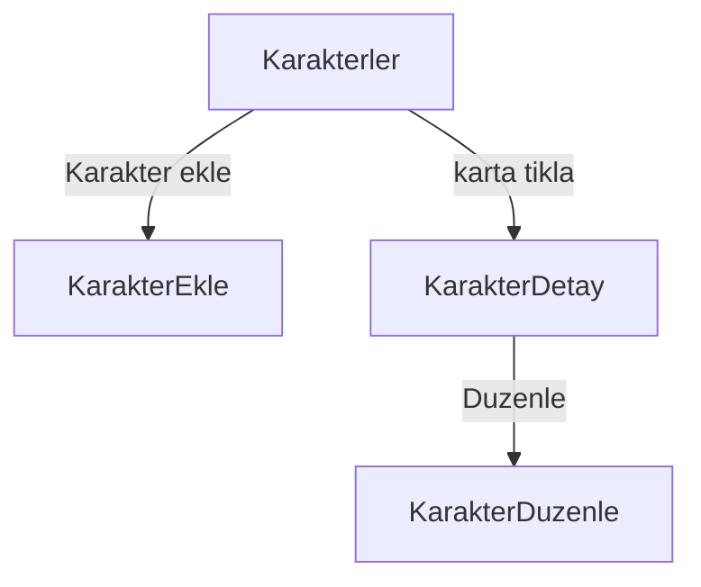
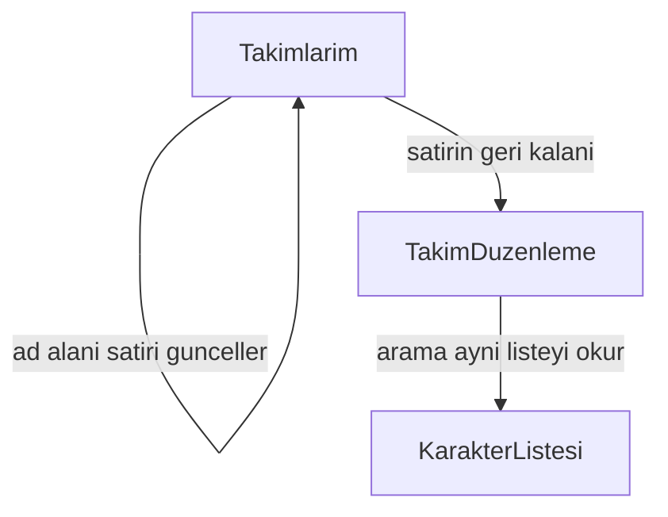
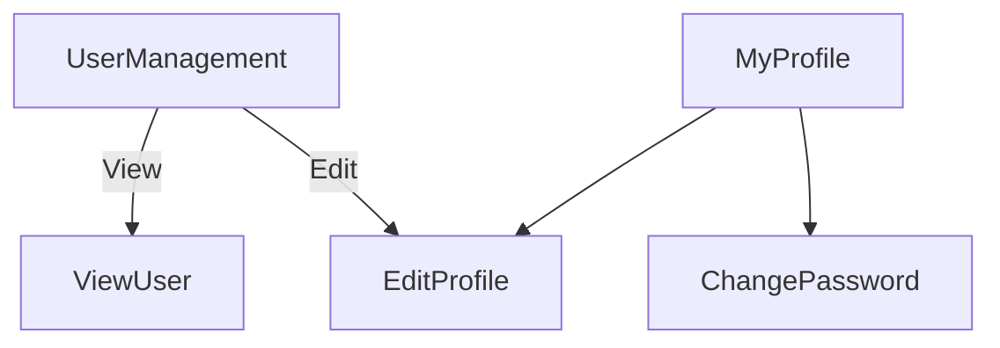
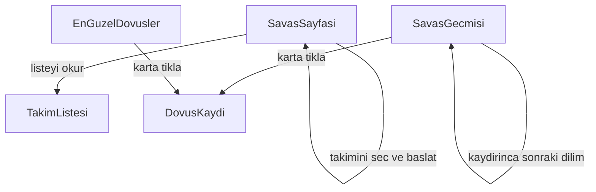
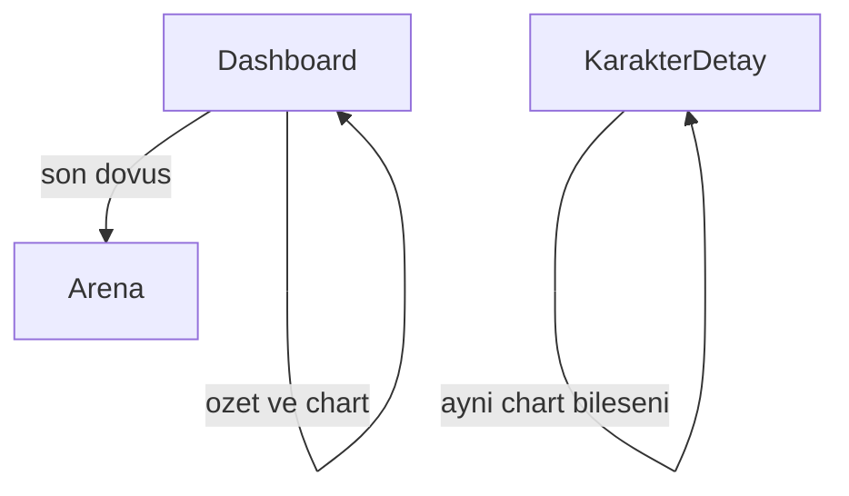
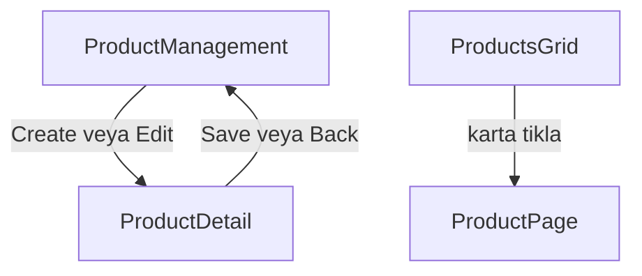

# Sayfa modeli — 14 Ekim 2026 (19 Ekim güncellendi)

Giriş yapılmış sayfalar Light Blue kabuktadır. Kabuk `AppLayout` içindedir. Sol menü ve üst çubuk `web/src/shell` altındadır. Giriş ve kayıt kabuğun dışında, mor palette kalır. Menü altı modülü taşır: dashboard, karakter, takım, kullanıcı, arena, e-ticaret. Girişten sonra varsayılan adres Dashboard’dur. E-ticaret dashboard ve savaş tablosundan sonra yapılır. Canlı özet: `CHECKPOINT.md` bölüm 1–2.

## Karakterler

Katalog paylaşılan listedir. Giriş yapmış herkes aynı karakterleri görür. `Universe` eserin dünyasıdır. `Karakter ekle` katalog kartını doğurur. Takıma üye yazmak bu modülün işi değildir.

Liste `GET /api/characters` ile dolar. İlk dilim `page` ve `pageSize` ile gelir. Arama aynı çağrıya metin ekler. ASP.NET liste action’ı query’yi okur. `HttpClient` yine `GET` atar.

- `/characters` liste ve arama
- `/characters/new` kataloga kart yazma
- `/characters/:id` detay
- `/characters/:id/edit` düzenleme

## Takımlar

Bir kullanıcının birden fazla takımı olur. Takımlarım yalnız onun satırlarını alta doğru dizer. Her takım yatay bir satırdır. Satırda sabit 5 yer vardır. Bütün takımlar aynı sayıya uyar. Dövüşe girmek için 5 yer de dolu olmalıdır.

Yeni takım boş satır olarak doğar ve aynı sayfada silinir. Her satırın adı ayrı bir alandan yazılır. O alana basmak düzenlemeye götürmez. Satırın geri kalanına basmak düzenlemeyi açar. Satır boş da olsa dolu da olsa aynı kapı çalışır. Ad alanı takım satırını günceller. Satıra tıklamak adres değiştirir. Düzenleme sayfası kendi `GET` isteğini atar.

Düzenlemede üstte takımın yerleri durur. Altta karakter aranır. Arama katalog listesiyle aynı `GET` çağrısıdır. Bu sayfada katalog oluşturma yoktur. Karakter sürüklenince bir yere girer veya takımdan çıkar. Ekle butonu da aynı üyeliği yazar. Üyelik, takım kimliği ile karakter kimliğini bir satıra kaydeder. Çıkarma o satırı siler. Sınır dolunca yeni karakter girmez.

## Kullanıcı

User modülü Light Blue şablonundaki ekranlardır. Giriş ve kayıt bu modüle girmez. Menüde Users tabloyu açar. User Management altında My Profile, Edit Profile ve Change Password durur.

User Management bir tablodur. Kolonlar avatar, ad, soyad, telefon, e-posta, rol, disabled ve aksiyonlardır. Aksiyonlar View, Edit ve Delete’tir. Tabloda arama ve sayfa boyutu vardır. Liste `GET /api/users` ile dolar. View tek kaydı `GET /api/users/{id}` ile salt okunur açar. Delete `DELETE /api/users/{id}` olur ve `users.delete` iznine bakar.

Edit Profile ad, soyad, telefon, e-posta ve avatar yazar. Save, Reset ve Cancel durur. Aynı form hem tablodan açılan düzenlemede hem kişinin kendi profilinde kullanılır. Change Password mevcut parolayı, yeni parolayı ve tekrarını alır.

My Profile iki parçadır. Solda kapak, avatar, ad ve iletişim durur. Sağda Activities kolonu durur. Yazı, yorum ve Post kutusu o kolondadır.

## Arena

Savaş sayfası kullanıcının takımını seçtirir ve dövüşü başlatır. Kapı sade kalır. Sayfa açılınca takım listesi okunur. Bu okuma Takımlarım’ın listesiyle aynıdır. Başlatma `POST /api/battles` ile `{ teamId }` gider. Rakip, hesap ve sonuç aynı cevapta döner. Sayfa cevabı kendi içinde aralıklı oynatır. Ayrı oyun sayfası açılmaz. Formül, puan ve WebSocket kararı `CHECKPOINT.md` bölüm 2’dedir.

Savaş geçmişi, kullanıcının başlattığı veya rakip olduğu bitmiş dövüşleri grid’de gösterir. İlk dilim çizilir. Listenin sonu görünürse sonraki dilim gelir. Her dilim `page` ve `pageSize` ile bir `GET` olur. ASP.NET bunu `Skip` ve `Take` ile okur. Karta basınca `GET /api/battles/{id}` olay listesini getirir.

En güzel dövüşler `/arena/highlights` rotasındadır. Liste `IsHighlighted` işaretli dövüşleri okur. İşareti kim koyacağı sonraki iştir.

- `/arena` — takım seç, başlat, oynat
- `/arena/history` — kişisel geçmiş
- `/arena/highlights` — seçilmiş dövüşler
- `/arena/battles/:id` — kayıtlı olay listesi

## Dashboard

Dashboard Light Blue yerleşimindedir. Üstte özet şeritler, ortada büyük panel, yanında istatistik, altta chart kutuları ve listeler durur. Chart bileşeni bir kez yazılır. Dashboard ve karakter detayı onu kendi sayılarıyla çağırır. SPA’da bileşen import edilir. ASP.NET’te her sayfa kendi `GET` query’sine gider.

Sayılar şablondan kopya yazı olmaz. İki kaynaktan gelir. Birinci kaynak dövüş ve katalog satırlarıdır: kazanma, puan, nadirlik, son dövüşler `GroupBy`, `Count` ve `Sum` ile okunur. İkinci kaynak dashboard seed verisidir: dünya haritası ve karakterin bölge bilgisi gibi paneller tabloya yazılır. Borsa, e-posta ve takvim kopyalanmaz. Yerlerine arena özeti, karakter dağılımı, puan şeridi ve son dövüş listesi konur.

Dashboard ekranı dövüş tablosundan sonra yapılır. Metne 19 Ekim’de girdi. Rota `/` (giriş sonrası varsayılan).

## E-ticaret

E-ticaret dashboard ve savaş tablosundan sonra yapılır. Dört ekran şablondaki yerleşimle durur. Vitrin ürünleri listeler. Puanla veya parayla satın alma bu sıranın ardından gelir. Add to Bag şablonda durur ve bu sırada sepete satır yazmaz.

Product Management yöneticinin tablosudur. Kolonlar kimlik, resim, başlık, alt başlık, fiyat ve yıldızdır. Create Product forma gider. Edit aynı formu doldurur. Delete satırı siler. Arama ve sayfa boyutu vardır. Liste `GET /api/products` ile dolar.

Product Detail, Edit product formudur. Resim, başlık, alt başlık, fiyat, indirim, iki açıklama, kod, hashtag, teknoloji ve yıldız buraya yazılır. Save `PUT /api/products/{id}` atar. Delete `DELETE` atar. Back tabloya döner. Resim, karakterdeki `ImageUrl` gibi bir adrestir.

Products Grid herkesin gezdiği vitrindir. Kartta resim, başlık, alt başlık, fiyat ve yıldız durur. Tip, marka, beden, renk, aralık ve sıralama aynı `GET` çağrısına query olarak gider. Karta basınca Product Page açılır. Grid satır yazmaz.

Product Page tek ürünü büyük resim, fiyat, açıklama, kod ve teknoloji ile gösterir. Altta benzer ürünler listeden gelir. Sayfa `GET /api/products/{id}` ile okunur. Beden, adet ve Add to Bag şablondaki yerindedir.

## Arena ve savaş — kilit özeti (19 Ekim 2026)

Ayrıntı `CHECKPOINT.md` bölüm 2’dedir. Kısa özet:

- 5’e 5; boş takım 400; rakip `POST` içinde (kullanıcı takımı veya sistem dizilimi).
- İki vuruş: `BaseAttack` sonra `BaseTechnique`. Isabet: `BaseAccuracy` vs `BaseForesight` (kura yok).
- Hesap tek `POST` cevabında; oynatma React aralığı. WebSocket / SignalR sonra.
- Kazanan 100, beraberlik 25, sistem dizilimine karşı puan yok.
- Highlights: `/arena/highlights`. Dashboard sayfa modelinde ayrı modül.
