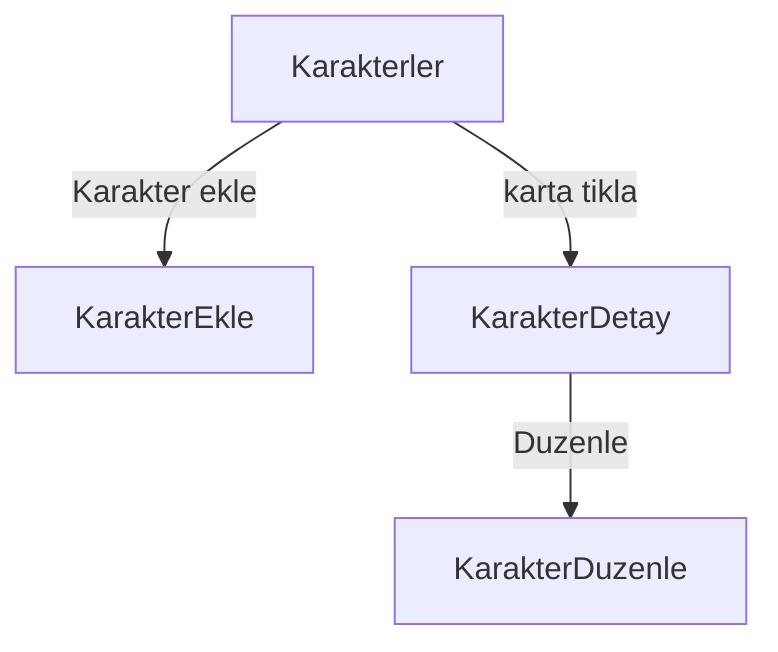
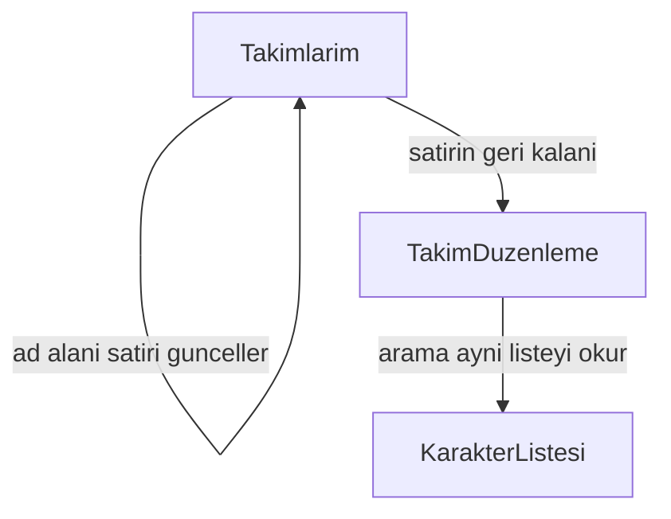
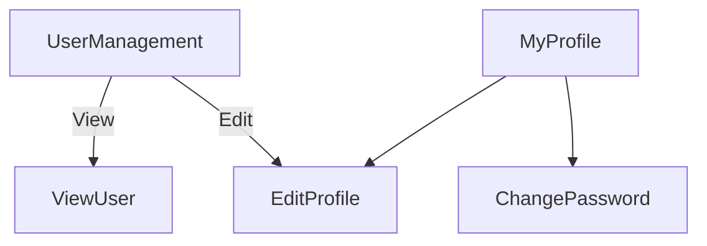
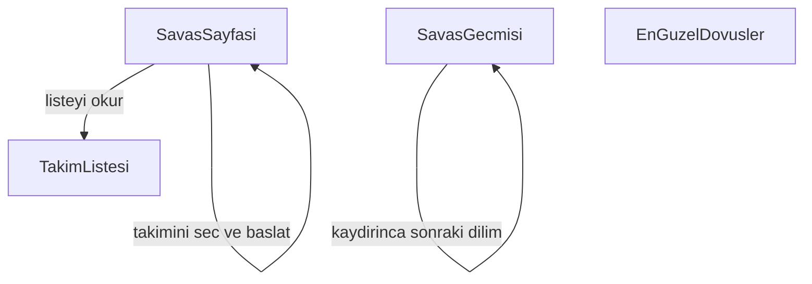
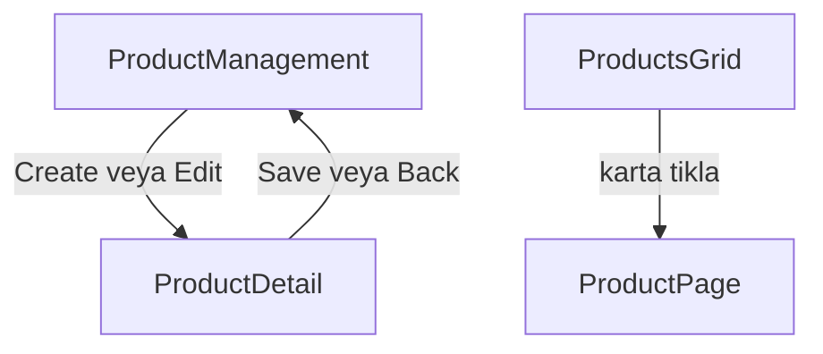

# Sayfa modeli — 14 Ekim 2026

Giriş yapılmış sayfalar Light Blue kabuktadır. Kabuk `AppLayout` içindedir. Sol menü ve üst çubuk `web/src/shell` altındadır. Giriş ve kayıt kabuğun dışında, mor palette kalır. Menü beş modülü taşır: karakter, takım, kullanıcı, arena, e-ticaret. E-ticaret savaş sayfasından sonra yapılır.

## Karakterler

Katalog paylaşılan listedir. Giriş yapmış herkes aynı karakterleri görür. `Universe` eserin dünyasıdır. `Karakter ekle` katalog kartını doğurur. Takıma üye yazmak bu modülün işi değildir.

Liste `GET /api/characters` ile dolar. İlk dilim `page` ve `pageSize` ile gelir. Arama aynı çağrıya metin ekler. ASP.NET liste action’ı query’yi okur. `HttpClient` yine `GET` atar.

- `/characters` liste ve arama
- `/characters/new` kataloga kart yazma
- `/characters/:id` detay
- `/characters/:id/edit` düzenleme

## Takımlar

Bir kullanıcının birden fazla takımı olur. Takımlarım yalnız onun satırlarını alta doğru dizer. Her takım yatay bir satırdır. Satırda sabit sayıda yer vardır. Sayı savaş sayfası kurulurken seçilir. Beklenti beştir. Altı veya yedi çıkarsa bütün takımlar aynı sayıya uyar.

Yeni takım boş satır olarak doğar ve aynı sayfada silinir. Her satırın adı ayrı bir alandan yazılır. O alana basmak düzenlemeye götürmez. Satırın geri kalanına basmak düzenlemeyi açar. Satır boş da olsa dolu da olsa aynı kapı çalışır. Ad alanı takım satırını günceller. Satıra tıklamak adres değiştirir. Düzenleme sayfası kendi `GET` isteğini atar.

Düzenlemede üstte takımın yerleri durur. Altta karakter aranır. Arama katalog listesiyle aynı `GET` çağrısıdır. Bu sayfada katalog oluşturma yoktur. Karakter sürüklenince bir yere girer veya takımdan çıkar. Ekle butonu da aynı üyeliği yazar. Üyelik, takım kimliği ile karakter kimliğini bir satıra kaydeder. Çıkarma o satırı siler. Sınır dolunca yeni karakter girmez.

## Kullanıcı

User modülü Light Blue şablonundaki ekranlardır. Giriş ve kayıt bu modüle girmez. Menüde Users tabloyu açar. User Management altında My Profile, Edit Profile ve Change Password durur.

User Management bir tablodur. Kolonlar avatar, ad, soyad, telefon, e-posta, rol, disabled ve aksiyonlardır. Aksiyonlar View, Edit ve Delete’tir. Tabloda arama ve sayfa boyutu vardır. Liste `GET /api/users` ile dolar. View tek kaydı `GET /api/users/{id}` ile salt okunur açar. Delete `DELETE /api/users/{id}` olur ve `users.delete` iznine bakar.

Edit Profile ad, soyad, telefon, e-posta ve avatar yazar. Save, Reset ve Cancel durur. Aynı form hem tablodan açılan düzenlemede hem kişinin kendi profilinde kullanılır. Change Password mevcut parolayı, yeni parolayı ve tekrarını alır.

My Profile iki parçadır. Solda kapak, avatar, ad ve iletişim durur. Sağda Activities kolonu durur. Yazı, yorum ve Post kutusu o kolondadır.

## Arena

Savaş modülü sayfa olarak durur. Dövüşün iç hesabı bu modelin dışındadır.

Savaş sayfası kullanıcının takımını seçtirir ve dövüşü başlatır. Kapı sade kalır. Sayfa açılınca takım listesi okunur. Bu okuma Takımlarım’ın listesiyle aynıdır. Başlatma `POST` ile gider. Hesap, rakip ve sonuç bu sayfanın içinde kalır.

Savaş geçmişi kullanıcının kendi bitmiş dövüşlerini grid’de gösterir. İlk dilim çizilir. Listenin sonu görünürse sonraki dilim gelir. Her dilim `page` ve `pageSize` ile bir `GET` olur. ASP.NET bunu `Skip` ve `Take` ile okur.

En güzel dövüşler herkesin gördüğü seçilmiş dövüşlerdir. Dashboard’da da durabilir, ayrı bir sayfada da.

## E-ticaret

E-ticaret savaş sayfasından sonra yapılır. Dört ekran şablondaki yerleşimle durur. Vitrin ürünleri listeler. Puanla veya parayla satın alma bu sıranın ardından gelir. Add to Bag şablonda durur ve bu sırada sepete satır yazmaz.

Product Management yöneticinin tablosudur. Kolonlar kimlik, resim, başlık, alt başlık, fiyat ve yıldızdır. Create Product forma gider. Edit aynı formu doldurur. Delete satırı siler. Arama ve sayfa boyutu vardır. Liste `GET /api/products` ile dolar.

Product Detail, Edit product formudur. Resim, başlık, alt başlık, fiyat, indirim, iki açıklama, kod, hashtag, teknoloji ve yıldız buraya yazılır. Save `PUT /api/products/{id}` atar. Delete `DELETE` atar. Back tabloya döner. Resim, karakterdeki `ImageUrl` gibi bir adrestir.

Products Grid herkesin gezdiği vitrindir. Kartta resim, başlık, alt başlık, fiyat ve yıldız durur. Tip, marka, beden, renk, aralık ve sıralama aynı `GET` çağrısına query olarak gider. Karta basınca Product Page açılır. Grid satır yazmaz.

Product Page tek ürünü büyük resim, fiyat, açıklama, kod ve teknoloji ile gösterir. Altta benzer ürünler listeden gelir. Sayfa `GET /api/products/{id}` ile okunur. Beden, adet ve Add to Bag şablondaki yerindedir.

## 2. Arena ve savaş — ön kapı

Bu bölüm 14 Ekim akşamı açıldı. Kod yazılmaz. Dövüş hesabı yarın ve sonraki günlerde gelişir. Bugün yalnız kapı konuşulur. Kapının üç seçeneği bu turda kilitlenmedi. Kapı sade kalacak, bir de eğlenceli olacak.

Arena menüden açılır. Sayfa giriş yapmış kullanıcının takımlarını okur. Bu okuma Takımlarım listesiyle aynıdır. Kullanıcı bir takımla dövüşe girer. Rakibin kapıda mı yoksa dövüşün içinde mi kurulacağı sonra konuşulur. Vuruş hesabı ve sonuç bu sayfanın içine sonra oturur.

Eğlence kapının bir köşesine kilitlenmedi. Eğlenceli olan tüm dövüş sistemidir. Fikir, farklı evrenlerden karakterlerin aynı arenada kapışmasıdır. One Piece’ten Luffy ile Game of Thrones’tan Sandor Clegane aynı sahada durur. Beşe beş örnektir. Yer sayısı savaş sayfası kurulurken seçilir.

Dövüş formülü yarın konuşulacak. Güç sayılarının adları bugün konuşuldu. `BaseAttack`, `BaseDefense` ve `BaseSpeed` durur. Yanlarına `BaseHealth`, `BaseTechnique` ve `BaseAccuracy` geldi. `BaseHealth` karakterin dövüşte ne kadar durduğudur. `BaseTechnique` normal vuruştan ayrı ikinci vuruştur. `BaseAccuracy` vuruşun karşıya denk gelmesidir.

Dördüncü iş hasardan kaçmak, daha az hasar almak ya da hasarı hiç yememektir. Bu sayının adı `BaseForesight` oldu. Vuruşu önceden görmektir. `BaseDefense` gelen hasarı azaltmaya devam eder. Kolon bugün yazılmaz. Formül yarın konuşulur.

Savaş geçmişi ve en güzel dövüşler kapının ardından gelir. Geçmiş, bitmiş dövüşleri grid’de ve dilim dilim gösterir. En güzel dövüşlerin dashboard’da mı, ayrı sayfada mı duracağı kapı netleşince bağlanır.
